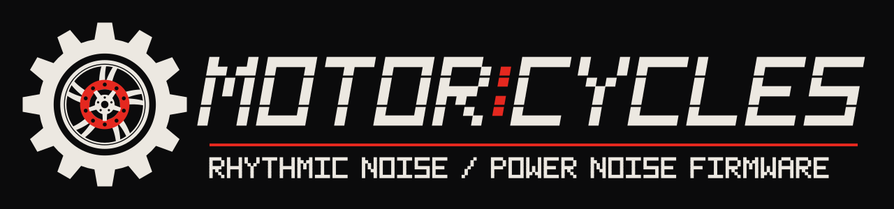

  

  <b><a href="https://nzimas.github.io/motorcycles/install.html">Open the patcher</a></b> ·
  <a href="https://nzimas.github.io/motorcycles/manual.html">Manual</a> ·
  <a href="https://nzimas.github.io/motorcycles/changelog.html">Changelog</a> ·
  <a href="https://github.com/nzimas/motorcycles/releases">All releases</a> ·
  <a href="#installing">How to install</a>

# Motor:Cycles

**Generative rhythmic-noise firmware for the Elektron Model:Cycles.**

Motor:Cycles turns the Model:Cycles into an instrument for **rhythmic noise and
power noise**, the hard, distorted, machine-driven end of the industrial music
family. It is not another general-purpose beat-making firmware. Every decision,
from the sound engines to the sequencing algorithms, serves one aesthetic:
pounding kicks, abrasive textures, mechanical repetition and controlled chaos.

At its heart is a set of **generative algorithms** that build sounds, kits,
phrases and whole patterns for you. A single control sets how complex, dense and
brutal the result is. You keep everything the Model:Cycles does by hand, but
the machine becomes a collaborator that keeps producing new material in the
style.

Motor:Cycles is built on the official Model:Cycles OS 1.13. It ships as a
**web patcher** that converts *your own copy* of the official firmware into
Motor:Cycles in your browser, on any computer, with nothing to install. No
Elektron code is distributed here.

---

## What Motor:Cycles adds

### Generators

Hold **PAGE** and press a pad to enter one of four generators. They work on
the selected track and the current pattern:

| Pad | Generator | What it creates |
|---|---|---|
| 1 | **Patch** | a new sound for the selected track |
| 2 | **Kit** | six matching sounds: kick, impact, metal/hat, percussion, texture, impact |
| 3 | **Phrase** | a new sequence, with parameter locks, for the selected track |
| 4 | **Pattern** | sequences for 3–6 tracks at once, plus tempo and length |

- **Steps 1–15 set the level.** The keys up to your level stay lit, like a
  bar filling from the left. Each generator remembers its own level.
  - For **Phrase and Pattern** the level is complexity and density: more hits,
    more parameter-lock lanes, ratchets, trig conditions and timing play.
  - For **Patch and Kit** it is tonal complexity and harshness: more drive,
    feedback, pitch sweep and modulation, and on the kick more punch, crunch
    and decay.
- **Step 16 generates.** Hold it for 1.5 seconds. The steps sweep from left to
  right and flash to confirm. After a Patch, a short tap on step 16 auditions
  the new sound.
- **PAGE + pad 5** opens a scale and root menu. Generated material follows it;
  the kick always sounds the chosen root.
- Tap **PAGE** to leave generator mode. The knobs always keep their normal
  functions.

**What the algorithms do**

- **Sounds.** About thirty sound recipes, built from measurements of the
  Model:Cycles' own synthesis engines, are drawn at random within ranges the
  level pushes towards harshness. Noise bursts, metallic clangs, feedback
  screams, inharmonic toms, crushed hats and drones are among them.
- **Kicks.** Track 1 is always the kick. Each seed picks one of seven measured
  characters: punch, knock, deep boom, rumble, feedback noise, tonal thud or
  gabber. Each has its own decay, pitch sweep, feedback and distortion.
- **Rhythm.**
  - Hits are placed by ranked rhythmic motifs, so density grows musically
    instead of randomly.
  - Pattern brings in 3–6 tracks, always including the kick.
- **Parameter locks.**
  - Lock "lanes" animate a parameter across the phrase: random per hit, ramps,
    accent-following, sparse spikes, or short cycles that drift against the
    bar.
  - Lock-only (trigless) steps animate between hits.
  - Locks stay close to each track's own sound, so a track remains
    recognisable however wild it gets.
- **Stereo.** Patterns spread the tracks across a balanced stereo field with
  pan locks that move within each track. The kick stays centred, and every
  downbeat is always centred.
- **Textures.** Texture tracks get sparse, long events, drifting timing,
  granular retrig smears and deep reverb and delay sends.
- **Every generation is new.** Each hold draws a fresh seed, mixed with the
  timing of your playing.

### Live breaks

While a pattern plays, **hold PAGE** to throw the whole pattern into a
breakcore-style variation, on every track that has content. Release PAGE and
the pattern carries on exactly as written. Every press draws a different
variation, so when and how often to break is up to you.

**Rhythm:** each press picks one of these.
- Beat-repeat stutters from the playhead (1, 2, 4 or 8 steps).
- Half-time drag or double-time rush.
- Reversed bars.
- Amen-style chops: the bar is cut into slices and reshuffled.
- Snare and hat rolls that accelerate the longer you hold.

**Movement:** each press layers one or more of these on top.
- Ping-pong or scattered panning. The kick stays centred on every beat.
- Timbre drift around each sound.
- Resonant filter sweeps on everything but the kick.
- Distortion pushed harder.
- Octave jumps, which always stay in key. The kick never moves.
- Extra ratchets.

There are no drops: no track is ever silenced, and the kick keeps driving.
Nothing is written to the pattern, so a break can never be saved by
accident. While a pattern plays, PAGE is the break key; generator mode and the
scale menu (PAGE + pads) are available when stopped.

**Keep a break as a pattern.** While you hold PAGE, the step keys show the
16 patterns of the current bank. A lit key means the pattern has trigs, and
the playing pattern's key flashes. Press a step key to store the break you're
hearing in that slot. The screen confirms it, for example STORED AS A10. An
empty slot takes it as a new pattern; a lit one is overwritten, and that
includes the playing pattern. Load it later with PATTERN + step, as usual.

The stored pattern holds:
- the rhythm the break plays;
- its panning, timbre and octave moves, as parameter locks;
- its ratchets, as retrigs;
- its filter sweeps (at their target) and distortion pushes, in the tracks'
  sounds.

Live, the movement draws afresh on every hit. The stored copy keeps one pass of
it.

### Per-track distortion

- **Stage.** Each track has its own distortion after the stock VOLUME+DIST
  stage: overdrive, a wavefolder, asymmetric bias, a tone control and a clean
  sub crossover that keeps the low end solid.
- **Never quieter.** It only ever adds density and loudness.
- **Noise gate.** A built-in gate stops it from turning silence into hiss.
- **Control.** **FUNC + SWEEP** sets the amount on the selected track; the
  screen shows a large **S** with the value.
- **Generators.** They set the distortion character of every sound they make.

### DJ-style resonant filter

- **One per track,** after the distortion: turn left for a resonant low-pass,
  right for a resonant high-pass, centre for off.
- **Control.** **FUNC + PITCH** sweeps it; the screen shows a large **F**.

### Per-track pan

- **Control.** **FUNC + VOLUME+DIST knob** pans the selected track. The screen shows
  a large **P** with LEFT, CENTRE or RIGHT, the amount and a bar from the
  centre.
- **An offset for the whole track,** saved with the sound and applied at the
  mixer, so it moves the sound at once. Pan movement from parameter locks,
  generated patterns and live breaks keeps going, but shifted left or right
  by your setting.
- **In Control All,** it moves all six tracks.

### Latched Control All

- **On and off.** **FUNC + TRK** turns Control All on. TRK stays lit and the
  screen blinks a large CTRL ALL. **FUNC + TRK** again turns it off.
- **Every knob changes all six tracks.** This includes the filter (FUNC +
  PITCH) and the distortion (FUNC + SWEEP).
- **Overrides parameter locks.** Unlike the stock Control All, a parameter you
  turn plays your value on every step, even locked ones.
- **Instant revert.** Turning the mode off brings every sound back to how it
  was at once, without reloading the pattern.

### LYRA

A new texture engine replaces the CHORD machine, which was costly on the CPU.
It is an economical voice inspired by the SOMA LYRA-8 organismic synthesiser:
- four oscillators in two pairs;
- each oscillator morphs from triangle to square (**SHAPE**);
- they cross-modulate each other from clean to chaotic (**SWEEP**);
- the second pair is detuned or set at intervals (**COLOR**);
- a "hyper LFO" ranges from slow drift to audio-rate growl (**CONTOUR**).

The generators use LYRA for drones, growls, interval haze and noise clouds.
Short renders are in [docs/lyra-previews](docs/lyra-previews).

### Included from Modded-Cycles

These mods from [Modded-Cycles](https://github.com/18nelli18/Modded-Cycles)
are part of Motor:Cycles:
- 6-channel USB audio;
- latching mutes;
- trig preview;
- scrolling long names;
- easier trig removal;
- the startup animation;
- the **MACRO** machine (Émilie Gillet's Braids models).

---

## Installing

You need:

- a computer with a current browser (Chrome, Edge, Firefox or Safari);
- the **official Model:Cycles OS 1.13** firmware file (`.syx`), downloaded from
  [elektron.se](https://www.elektron.se/support-downloads);
- [Elektron Transfer](https://www.elektron.se/support-downloads) to send the result to your
  Model:Cycles.

Steps:

1. Open the **[Motor:Cycles patcher](https://nzimas.github.io/motorcycles/install.html)**.
2. Drop the official `.syx` onto the page, or click to choose it.
3. Click **Save Motor:Cycles .syx**.
4. Send that file to your Model:Cycles with Elektron Transfer, as you would an
   official update.

Notes:
- The patcher only accepts the official OS 1.13 file. It rebuilds the firmware
  exactly the way the released build was made (the Modded-Cycles mods first,
  then Motor:Cycles on top) and checks every stage against known checksums.
  The result is byte for byte the file tested on a real Model:Cycles, or
  nothing is produced.
- Everything runs in your browser: your file is never uploaded.
- To go back, install the official OS 1.13 with Transfer the same way.

Back up your projects before installing.

---

## Building from source

- **Firmware build.** `firmware/build-selected.py --stock model-cycles_OS1.13.syx`
  - It needs the `m68k-elf` GCC toolchain and your own copy of the official
    firmware.
  - It applies the pinned Modded-Cycles tweaks (git submodule
    `reference/Modded-Cycles`) and builds the payload from `firmware/` and
    `generation/`.
- **Patch kit.** `tools/make_patchkit.py` turns a build into the patch kit,
  `docs/motorcycles.mcpatch`. `tools/apply_patchkit.py` is the reference
  implementation of the patcher.
- **The web patcher.** `docs/` is the GitHub Pages site: `docs/patcher.js`
  is the patcher core (a JavaScript port of the reference) and
  `docs/install.html` the page that runs it. The site also has a home page,
  `docs/manual.html` and `docs/changelog.html`. `node tools/check_web_patcher.mjs STOCK.syx
  EXPECTED.syx` checks that it reproduces a release byte for byte.
- **Tests.**
  - `make check` runs the host test suites: generators, interface, DSP and
    fuzzing.
  - `validation/test_selected_*.py` run the packaged firmware's own code in an
    emulator (Unicorn).

Technical notes:
- [firmware/DRIVE.md](firmware/DRIVE.md): distortion, gate and filter
- [firmware/CTRL-ALL.md](firmware/CTRL-ALL.md): latched Control All
- [firmware/LYRA.md](firmware/LYRA.md): the LYRA engine
- [firmware/BREAK.md](firmware/BREAK.md): live breaks
- [generation/sequence_encoding.md](generation/sequence_encoding.md):
  sequence encoding

---

## Credits

Motor:Cycles grew out of **[Modded-Cycles](https://github.com/18nelli18/Modded-Cycles)**
by **18nelli18 and the Modded-Cycles contributors**. That project mapped the
Model:Cycles firmware, built the toolchain to patch it safely, and created the
mods listed above. Motor:Cycles would not exist without it: thank you.

Motor:Cycles is a fundamentally different project, though:
- Modded-Cycles extends the stock instrument with a menu of independent,
  general-purpose mods.
- Motor:Cycles redefines the instrument around one genre and one idea:
  generative composition of rhythmic noise.
- Its generators, distortion and filter stages, latched Control All and LYRA
  engine are original work. So is everything they need in the firmware: the
  audio hooks, the per-sound storage, the on-screen overlays and the
  parameter-lock override.

Also with thanks to:

- **drumkilla** ([elektron-model-tweaks](https://github.com/drumkilla/elektron-model-tweaks)):
  the `mtlib` firmware toolkit (SysEx transport, container, aPLib). The web
  patcher's core is a JavaScript port of it. Latching mute, trig preview and
  scrolling names also come from this project.
- **Scott Metoyer** ([ms-multi-output](https://github.com/scottmetoyer/ms-multi-output)):
  the original multi-channel USB audio mod.
- **Émilie Gillet** ([pichenettes/eurorack](https://github.com/pichenettes/eurorack)):
  the Braids code behind the MACRO machine.
- **SOMA Laboratory** (LYRA-8), **Mike Moreno** ([LIRA-8](https://github.com/MikeMorenoDSP/LIRA-8))
  and **xmacex** ([LNRA-8](https://github.com/xmacex/lnra-8)): the inspiration
  for the LYRA engine. No code from them is used.

Licence texts are in [third-party-notices/](third-party-notices/).

---

## Disclaimer

**Use Motor:Cycles at your own risk.**

- Installing custom firmware on your Model:Cycles **may void its warranty**,
  if it is still under any warranty. By installing it, you accept that, and
  you take full responsibility for the result.
- Motor:Cycles has been tested on a real Model:Cycles, and there it works as
  specified. That does not guarantee it will work for everyone, on every unit,
  or with every project. Back up your projects first. If something goes wrong,
  reinstall the official OS 1.13.
- Motor:Cycles is provided "as is", without warranty of any kind (see the
  [licence](LICENSE)).
- Motor:Cycles is an independent project. It is **not affiliated with,
  endorsed by or supported by Elektron**. Please don't contact Elektron
  support about it.
- Elektron and Model:Cycles are trademarks of Elektron Music Machines MAV AB.
  They are used here only to say which instrument this firmware is for.

## Licence

[MIT](LICENSE) © 2026 Nuno Zimas.
